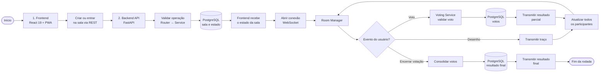

## 1. Problem

Choosing a movie as a group requires gathering options and reconciling preferences. When everyone uses a different list, the decision loses context and votes become difficult to follow.

## 2. Target audience

Groups that want to organize movie options, draw a choice, or vote in a shared room.

## 3. Solution

**Cine Random** combines a React interface with a FastAPI. The application can also be installed as a PWA:

- **Filtered draw:** Select movies by genre, streaming service, year, and rating.
- **Group voting:** Participants join the same room; WebSockets synchronize votes.
- **Invitations:** Create cards with the movie and session date.

## 4. Architecture and technical decisions

- **Separation of responsibilities:** HTTP and WebSocket routes, services, and repositories organize data input, voting rules, and persistence.
- **Synchronization:** WebSockets update the room state for connected participants.
- **PWA:** The interface supports installation and static-file caching.
- **Documentation:** The repository includes architectural decision records.

## 5. Implementation challenges

- **Simultaneous votes:** Consensus validation must account for updates received almost simultaneously in the same room.
- **Test isolation:** The suites use fixtures and mocks to exercise the API without depending on external TMDB and Google OAuth responses.

## 6. Result

- The [published application](https://cinerandomseven.vercel.app) lets users test drawing and voting. The [repository](https://github.com/LucasAlvesLougon/cine_random) contains the implementation, tests, and API documentation.
