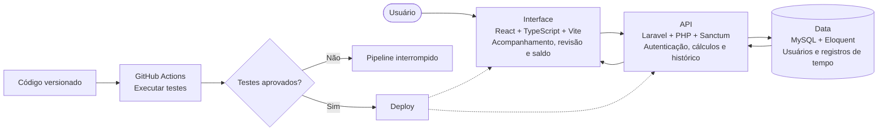

## 1. Problem

Freelancers, service providers, and small teams need to track work hours and breaks. To follow their hour balance, they also need to understand which time entries and adjustments were included in the calculation.

## 2. Target audience

Freelancers, consultants, and small teams that need to review time entries, breaks, and balances in one place.

## 3. Solution

**MuPonto** is a web application published at [muponto.com](https://muponto.com). The interface and API are developed separately:

- **Time tracking:** Clock-ins, breaks, and clock-outs are associated with recorded timestamps.
- **Balance calculations:** Server-side rules account for worked hours, deficits, and configured tolerances.
- **Adjustment history:** Manual corrections require a reason and preserve authorship and edit-time data (`edited_at`, `edited_by`).
- **Reports:** Export of records as CSV and PDF.
- **Authentication:** Access through Google OAuth or email and password, with Laravel Sanctum in the API.

## 4. Architecture and technical decisions

 

- **Separation between interface and API:** The application and API are hosted at `muponto.com` and `api.muponto.com`. The backend applies user scopes when querying data.
- **Time handling:** The project describes storing timestamps in UTC and converting them to the user's time zone in the interface.
- **Interface state:** TanStack Query manages query caching and invalidation after changes.
- **Delivery:** GitHub Actions workflows run tests and publish changes to the environment hosted on Hostinger.

## 5. Repositories and production links

- **Live application (production):** [https://muponto.com](https://muponto.com)
- **Production API (health check):** [https://api.muponto.com/up](https://api.muponto.com/up)
- **Frontend repository:** [LucasAlvesLougon/gestao_ponto_web](https://github.com/LucasAlvesLougon/gestao_ponto_web)
- **Backend repository:** [LucasAlvesLougon/gestao_ponto_api](https://github.com/LucasAlvesLougon/gestao_ponto_api)

## 6. Implementation challenges

- **Shifts with multiple breaks:** `PunchCalculationService` centralizes calculation rules so that time entries are processed on the server.
- **FTP deployment:** The workflow had to adapt deployment paths to the shared hosting environment.
- **Two authentication modes:** Google OAuth and local credential flows converge on the session managed by Laravel Sanctum.

## 7. Result

- The application is available at [muponto.com](https://muponto.com). The [interface](https://github.com/LucasAlvesLougon/gestao_ponto_web) and [API](https://github.com/LucasAlvesLougon/gestao_ponto_api) repositories make the implementation and test suites available for review.
