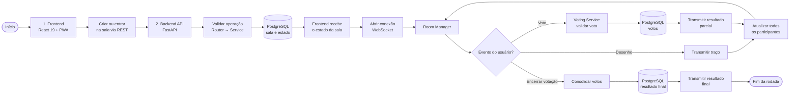

## 1. Problema

Escolher um filme em grupo exige reunir opções e conciliar preferências. Quando cada pessoa usa uma lista diferente, a decisão perde contexto e fica difícil acompanhar os votos.

## 2. Público-Alvo

Grupos que querem organizar opções de filmes, sortear uma escolha ou votar em uma sala compartilhada.

## 3. Solução

O **Cine Random** combina uma interface React com uma API FastAPI. A aplicação também pode ser instalada como PWA:

- **Sorteio com filtros:** Seleção de filmes por gênero, serviço de streaming, ano e nota.
- **Votação em grupo:** Participantes entram na mesma sala; WebSockets sincronizam os votos.
- **Convites:** Criação de cartões com filme e data da sessão.

## 4. Arquitetura e Decisões Técnicas

- **Separação de responsabilidades:** Rotas HTTP e WebSocket, serviços e repositórios organizam a entrada de dados, as regras de votação e a persistência.
- **Sincronização:** WebSockets atualizam o estado da sala para os participantes conectados.
- **PWA:** A interface inclui suporte à instalação e cache de arquivos estáticos.
- **Documentação:** O repositório inclui registros de decisões arquiteturais.

## 5. Desafios de implementação

- **Votos simultâneos:** A validação do consenso precisa considerar atualizações recebidas quase ao mesmo tempo na mesma sala.
- **Isolamento de testes:** As suítes usam fixtures e mocks para exercitar a API sem depender das respostas externas do TMDB e do Google OAuth.

## 6. Resultado

- A [aplicação publicada](https://cinerandomseven.vercel.app) permite testar o sorteio e a votação. O [repositório](https://github.com/LucasAlvesLougon/cine_random) reúne a implementação, os testes e a documentação da API.
