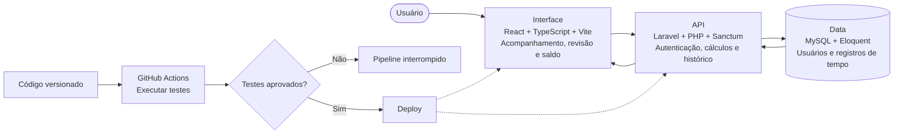

## 1. Problema

Profissionais autônomos, prestadores de serviços e equipes pequenas precisam registrar jornadas e intervalos. Para acompanhar o saldo de horas, também precisam entender quais marcações e ajustes foram considerados no cálculo.

## 2. Público-Alvo

Profissionais autônomos, consultores e equipes pequenas que precisam consultar marcações, intervalos e saldos em um mesmo lugar.

## 3. Solução

O **MuPonto** é uma aplicação web publicada em [muponto.com](https://muponto.com). A interface e a API são desenvolvidas separadamente:

- **Registro de jornada:** Entradas, intervalos e saídas são associados a horários de marcação.
- **Cálculo de saldo:** As regras no servidor consideram horas trabalhadas, débitos e tolerâncias configuradas.
- **Histórico de ajustes:** Correções manuais exigem justificativa e preservam dados de autoria e horário da edição (`edited_at`, `edited_by`).
- **Relatórios:** Exportação dos registros em CSV e PDF.
- **Autenticação:** Acesso por Google OAuth ou e-mail e senha, com Laravel Sanctum na API.

## 4. Arquitetura e Decisões Técnicas

 

- **Separação entre interface e API:** A aplicação e a API são hospedadas em `muponto.com` e `api.muponto.com`. O backend aplica escopos de usuário na consulta aos dados.
- **Tratamento temporal:** O projeto descreve o armazenamento em UTC e a conversão para o fuso do usuário na interface.
- **Estado da interface:** TanStack Query gerencia cache e invalidação das consultas após mudanças.
- **Entrega:** Workflows do GitHub Actions executam testes e publicam as alterações no ambiente hospedado na Hostinger.

## 5. Repositórios e Links em Produção

- **Aplicação no Ar (Produção):** [https://muponto.com](https://muponto.com)
- **API em Produção (Health Check):** [https://api.muponto.com/up](https://api.muponto.com/up)
- **Repositório Frontend:** [LucasAlvesLougon/gestao_ponto_web](https://github.com/LucasAlvesLougon/gestao_ponto_web)
- **Repositório Backend:** [LucasAlvesLougon/gestao_ponto_api](https://github.com/LucasAlvesLougon/gestao_ponto_api)

## 6. Desafios de implementação

- **Jornadas com múltiplos intervalos:** O `PunchCalculationService` concentra as regras de cálculo para que as marcações sejam processadas no servidor.
- **Deploy por FTP:** O workflow precisou adaptar os caminhos de publicação ao ambiente de hospedagem compartilhada.
- **Dois modos de autenticação:** Os fluxos de Google OAuth e credenciais locais convergem para a sessão gerenciada pelo Laravel Sanctum.

## 7. Resultado

- A aplicação está acessível em [muponto.com](https://muponto.com). Os repositórios de [interface](https://github.com/LucasAlvesLougon/gestao_ponto_web) e [API](https://github.com/LucasAlvesLougon/gestao_ponto_api) permitem examinar a implementação e as suítes de testes.
